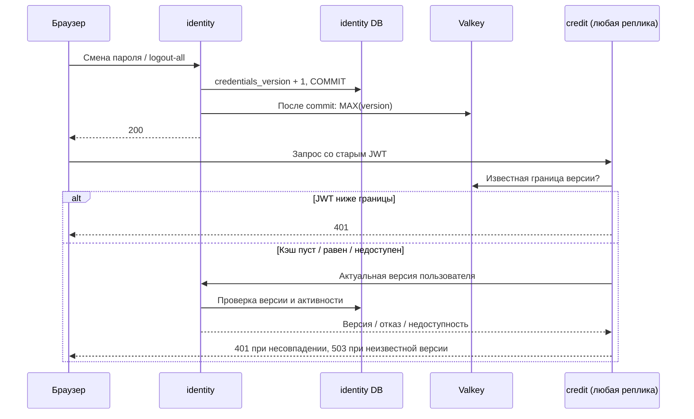
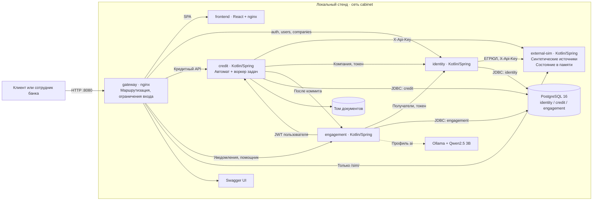
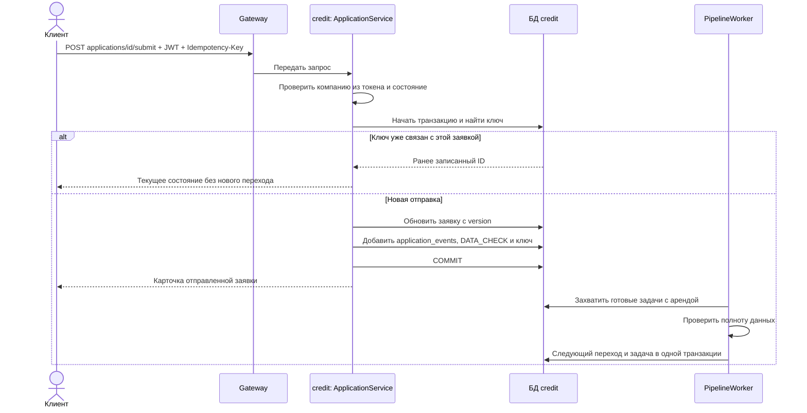
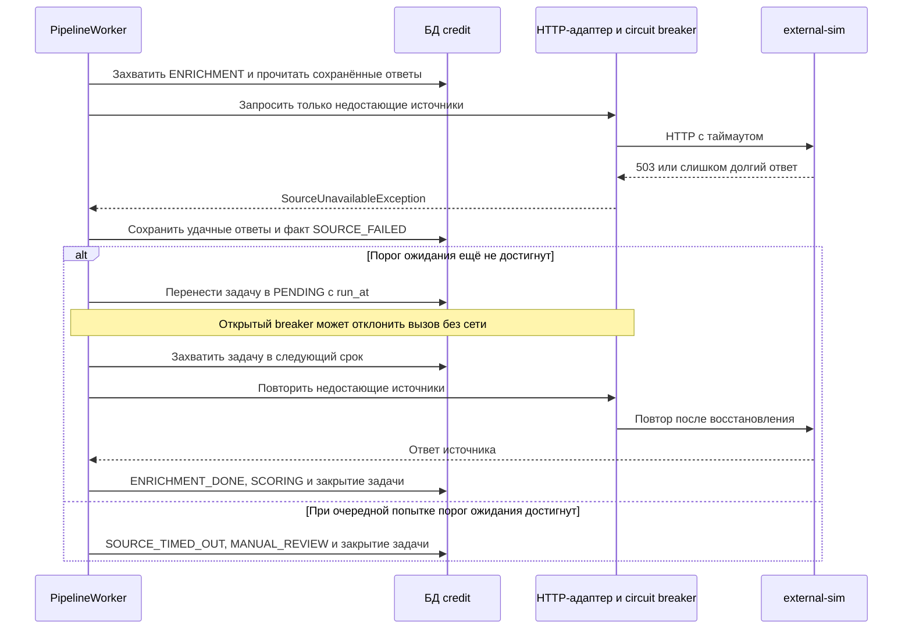
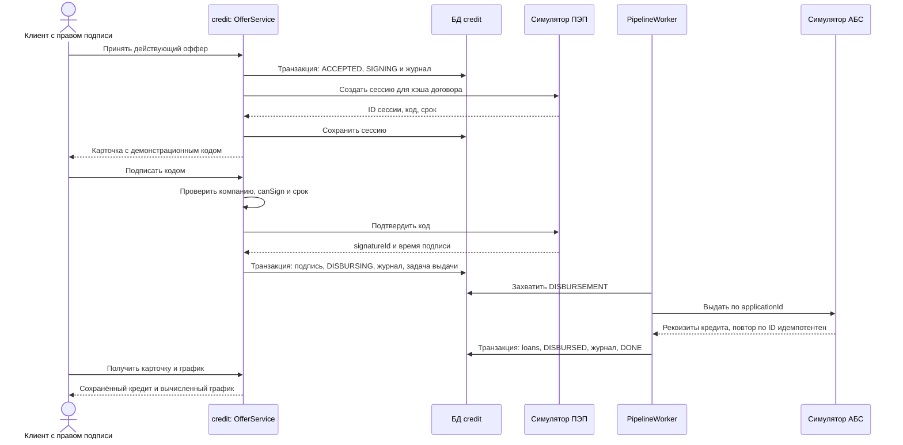
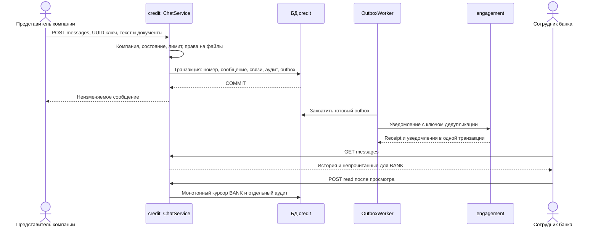

# Архитектура

Базами владеют отдельные *_owner; HTTP-процессы работают как *_app без DDL и доступа
к чужим базам. Миграции выполняются из тех же JAR до запуска приложений.
[Схема старта и границы прав](database-isolation.md).

`platform-common/limits` содержит общий адаптер Valkey и атомарные скользящие окна.
Identity, credit и engagement обращаются к одному частному Valkey; отдельный MVC
interceptor ограничивает помощника до контроллера. `security/RevocationWatermarks`
публикует версии после commit и ускоряет только отказ JWT; разрешение всегда требует
актуальной identity. [ADR 013](adr/013-shared-limits-and-revocation.md).



Переписка живёт в `credit/chat`: controller вызывает application-сервис, доменные
ограничения и порты JDBC/документов/лимита. Сообщение, отдельный аудит и уведомление
outbox атомарны; финансовый агрегат и бизнес-журнал не меняются. Вложения используют
прежнее закрытое хранилище с контекстом `CHAT`. Решение — [ADR-011](adr/011-application-chat.md).

Редактор продуктов находится в `credit/product`: controller вызывает application-сервис,
который проверяет роль и доменные ограничения, а порт `ProductVersions` сохраняет новую
версию через JDBC. Публичный `ProductCatalog` читает только текущие активные условия.
Подача заявки фиксирует выбранную версию и версии альтернатив; все последующие шаги
работают с этим снимком, включая выключенные позднее продукты. Договор и выдача читают
версию из предложения. Подробное решение — [ADR-010](adr/010-product-versions.md).

Кабинет — четыре сервиса на Spring Boot (Kotlin), SPA на React и PostgreSQL.
В основе — доменные модули и порты, подписанный JWT и владение данными по сервисам.
Стенд является прототипом: внешние системы и компании синтетические.

```
Браузер ──▶ gateway (nginx :8080)
              ├─ /api/v1/auth, /users, /companies ─────────────▶ identity      ──▶ PostgreSQL: identity
              ├─ /api/v1/products, /applications,
              │  /underwriting, /rules, /analytics ────────────▶ credit        ──▶ PostgreSQL: credit, том с документами
              ├─ /api/v1/notifications, /assistant ────────────▶ engagement    ──▶ PostgreSQL: engagement
              ├─ /sim/ (пульт демо) ───────────────────────────▶ external-sim
              ├─ /swagger/ ────────────────────────────────────▶ swagger-ui (документация всех сервисов)
              └─ / ────────────────────────────────────────────▶ frontend (nginx со сборкой SPA)

credit ──▶ external-sim   ЕГРЮЛ/ЕГРИП, ФНС, БКИ, подписание, АБС (таймауты, повторы)
credit ──▶ identity       /internal/v1/companies, /internal/v1/users
credit ──▶ engagement     /internal/v1/notifications (после коммита, без влияния на действие)
engagement ──▶ ollama     помощник на модели с открытыми весами (профиль ai)
```

## Сервисы

| Сервис | Отвечает за | Данные |
| --- | --- | --- |
| identity | Вход, регистрация компании по ИНН, роли, токены, согласия 152-ФЗ | users, companies, personal_data_consents |
| credit | Продукты, заявки и их автомат статусов, конвейер (проверка полноты, обогащение, скоринг, решение), офферы, подписание, выдача, документы | своя база + том для файлов |
| engagement | Уведомления в кабинете, ИИ-помощник | своя база |
| external-sim | Симуляторы внешних систем на синтетических данных | без базы |

**Почему credit — один сервис.** Каждый шаг конвейера меняет один агрегат — заявку — и в той
же транзакции пишет журнал событий и следующую задачу. Раздельные сервисы потребовали бы
распределённых транзакций или брокера с outbox на каждом шаге без выигрыша для MVP. Модули
внутри (`application`, `pipeline`, `scoring`, `decision`, `offer`, `document`) разделены
портами, так что вынести любой можно позже.

**Почему документы в credit, а не отдельным file-сервисом.** Отдельный файловый сервис обычно
отдаёт файл по неугадываемой ссылке без входа. Финансовые документы компании так отдавать нельзя:
скачать файл может только представитель компании-владельца заявки или сотрудник банка, а права на
заявку знает только credit. Поэтому модуль `document` сам проверяет содержимое (сигнатура файла
должна совпадать с расширением), лимит загрузок и антивирус, а сами файлы лежат за портом
`FileStore`: в томе Docker или в S3-совместимом хранилище (ADR 012).

## Правила взаимодействия

- **Аутентификация.** Токены выпускает только identity: в них роль, имя, email, `cid` —
  компания клиента и `sign` — право подписи. Остальные сервисы проверяют подпись JWT сами
  (`JwtVerifier` из platform-common) и берут пользователя из claims; отозванные токены
  (блокировка, смена пароля) отсекаются по точному `credentialsVersion` через identity на каждом запросе.
  Неизвестное состояние сессии при сбое identity возвращает 503; прежний успешный ответ не используется.
- **Права — по токену, не по данным запроса.** `companyId` никогда не принимается из тела
  или параметров: клиент видит только заявки своей компании, чужие отвечают 404.
- **Внутренние API** (`/internal/**`) не публикуются gateway.
- **Недоступность соседа** не валит вызывающего: частичный ответ или повтор позже, а не 500.

## Безопасность

- Каждый сервис пропускает без токена только явно перечисленные пути
  (`cabinet.security.public-endpoints`), остальное — 401 до контроллера.
- Пароли — bcrypt, от 8 символов с буквами и цифрами; 5 неверных попыток за 15 минут
  блокируют вход в учётную запись; gateway ограничивает `/api/v1/auth/` 30 запросами в минуту с адреса.
- Регистрация без согласия на обработку персональных данных невозможна. Триггер запрещает
  UPDATE согласия; DELETE этим триггером не запрещён, см. [модель данных](data-model.md).
- Компания подключается один раз: повторная регистрация с тем же ИНН отклоняется, чтобы
  никто не попал в чужой кабинет, зная ИНН.
- CSP: только свои скрипты и свой API; запрет встраивания во фреймы.
- Образы: непривилегированный пользователь, сканирование Trivy в CI.

## Кредитный конвейер

Шаги после отправки заявки выполняет воркер внутри credit (`pipeline/`):

- **Задачи — в той же транзакции, что и переход.** Смена статуса, запись в журнал и следующая
  задача (`pipeline_jobs`) сохраняются вместе (transactional outbox). Воркер берёт задачи
  `FOR UPDATE SKIP LOCKED` с арендой: одновременные захваты разделяются блокировкой,
  а задачу упавшего экземпляра можно подхватить после аренды. Истечение аренды допускает
  повторное выполнение: отсутствие повторного бизнес-эффекта требует идемпотентности
  интеграций и согласованных транзакций, а не только `SKIP LOCKED`.
- **Внешние вызовы — вне транзакции.** Шаг сначала опрашивает источники, затем одной
  транзакцией сохраняет результат и закрывает задачу. Медленный источник не держит соединение
  с базой.
- **Сбой источника — не сбой заявки.** У каждого источника свой circuit breaker
  (Resilience4j): после серии отказов источник временно не опрашивается. Заявка остаётся в
  `ENRICHMENT`, в журнале — `SOURCE_FAILED`, повтор через 5 с, 30 с, 2 мин, далее раз в 5 мин;
  при очередной обработке после порога `SOURCE_TIMEOUT` заявка уходит андеррайтеру
  с причиной `SOURCE_UNAVAILABLE`. Следующий запуск ограничен дедлайном ожидания;
  очередь и длительность самого внешнего вызова могут задержать фактический переход.
  Уже полученные ответы источников сохранены и повторно не запрашиваются.
- **Решение воспроизводимо.** Скоринг (`assessment/domain/Scorecard.kt`) и кредитная политика
  (`CreditPolicy.kt`) — чистые функции без ввода-вывода. Решение (`decisions`) хранит версию
  набора правил (`rule_sets`), все входные данные и баллы по каждому фактору.
- **Сроки — тоже задачи.** Истечение запроса документов и оффера — отложенные задачи; если
  срок сдвинулся (новый запрос), задача переносится, а не срабатывает раньше времени.
- **Выдача идемпотентна.** АБС возвращает тот же кредит при повторе по той же заявке, поэтому
  повтор после сбоя безопасен.

## Уведомления

Основной сценарий работает только через кабинет. Дополнительное дублирование важных
событий на почту включается профилем `mail` и отдельно самим получателем; SMS и
мессенджеры не участвуют.

- `TransitionNotices` формирует событие, а credit сохраняет его в `delivery_outbox`
  в транзакции перехода. Identity использует тот же общий очередной механизм в своей БД.
  Сбой engagement не отменяет действие: независимый доставщик повторяет отправку с арендой.
- Engagement атомарно фиксирует receipt события и уведомления адресатов. Повтор после
  потери HTTP-ответа не добавляет уведомления и не расширяет первоначальный набор людей.
  Аренда защищена случайным claim token, число попыток ограничено; подробнее
  [ADR 009](adr/009-durable-notification-delivery.md).
- Адресат — компания клиента или роль банка. engagement разворачивает адрес в людей через
  внутренний API identity и хранит строку на человека, поэтому «прочитано» у каждого своё.
- Ключ дедупликации (событие журнала + адресат) делает повторную доставку безвредной.
- Ссылки — только пути внутри кабинета; внешний адрес отклоняется.
- Почтовое задание в engagement сохраняется вместе с уведомлением, но отправляется
  независимо по SMTP. Письмо составляется по типу события, не из бизнес-текста уведомления:
  в нём нет суммы, причин отказа, ФИО или сведений о компании. Получатель определяется
  перед отправкой; заблокированный сотрудник не получает письмо.
- Отдельный scheduler доставки не занимает потоки, на которых продвигается кредитный
  конвейер. У почтовых и внутрисистемных попыток общие аренда/backoff/fencing и раздельные
  каналы. Метрики общего состояния БД агрегируются по максимуму между репликами.
- Клиент узнаёт о том, что требует его действия (запрос документов, предложение) и об итогах
  (отказ, выдача, закрытие); андеррайтеры — о заявках, ждущих ручного решения.

## ИИ-помощник

ИИ используется там, где он помогает понять, а не там, где принимает решения: скоринг и
кредитная политика — прозрачные правила.

- **Только факты.** Ответ строится из справки (`assistant/Knowledge.kt`, отбор статей по
  вопросу) и данных заявки, которые engagement читает у credit **токеном самого пользователя**:
  помощник видит ровно то, что видит человек, чужая заявка — 404.
- **Маршрутизация фактов заявки.** Распознанные вопросы о своей заявке (почему отказ,
  условия предложения, документы, статус) получают ответ по правилам. Это классификация
  текста, а не гарантия для любой формулировки: контрольный A08 о черновике дошёл до модели,
  которая выдумала одобрение. Существующий guard пропустил ответ; дефект описан в
  [контрольном прогоне](assistant-eval.md). Код помощника в этом спринте защищён от изменений.
- **Модель с открытыми весами — для объяснений.** Qwen2.5 3B (Qwen Research License —
  некоммерческое использование; для коммерческого использования нужна подходящая лицензия
  и отдельная приёмка качества выбранных весов)
  в Ollama объясняет термины и продукты по справке; температура 0,2, ответ простым текстом. Правила модели: не
  придумывать суммы и решения, не обещать одобрения, не выполнять просьб из вопроса, которые им
  противоречат. Эти инструкции не гарантируют правильность. Воспроизводимый прогон данного
  спринта выполнен только с 1.5B под Apache-2.0; качество не принято из-за ложного одобрения
  и неподтверждённых юридических советов. Превосходство 3B этим прогоном не проверялось.
- **Проверка чисел.** Каждое число в ответе модели должно встречаться в справке, данных заявки или
  вопросе; иначе показывается ответ по правилам, а случай пишется в лог.
- **Работает и без модели.** Если Ollama не запущена или не ответила, тот же вопрос получает
  ответ по правилам из тех же справки и фактов; режим виден в окне помощника.
- **Ограничения.** Вопрос до 500 символов, 20 вопросов за 10 минут на человека, ответ
  показывается как текст, без разметки.

## Контейнеры и границы доверия

Диаграмма описывает Compose-стенд. Три логические базы находятся в одном контейнере
PostgreSQL; внешние ключи между базами отсутствуют. Через порт хоста опубликован только
gateway. Сеть Compose является доверенной границей внутренних API; аутентификация
`/internal/` самим приложением не заменяет эту сетевую границу.



При масштабировании `credit` в одном Compose-проекте экземпляры получают общий том
документов и одну базу. На разных серверах локального тома недостаточно: требуется
общее хранилище и отдельная проверка доступности файлов, см. [ADR 007](adr/007-documents-in-credit.md).
Шифрование внешнего соединения и настройки сервера относятся к комплекту развёртывания;
базовый Compose по умолчанию использует HTTP.

## Отправка заявки



`companyId` клиента не выбирается из тела запроса. При конфликте конкурентного изменения
сохранение версии приводит к 409; измерение гонок должно проверять также журнал и задачи.

## Обогащение при отказе источника



Внешние запросы шагов не держат транзакцию изменения заявки. Сохранение результата
и следующего состояния выполняется короткой транзакцией. Это описание механизма;
пропускная способность и отсутствие потерь проверяются отдельными экспериментами.

## Принятие, подписание и выдача



Если создание сессии подписи не удалось после принятия оффера, клиент может запросить
новый код. Состояние симулятора подписи живёт в памяти: перезапуск симулятора требует
новой сессии, хотя сохранённые данные заявки в `credit` сохраняются.

## Переписка и доставка второй стороне


