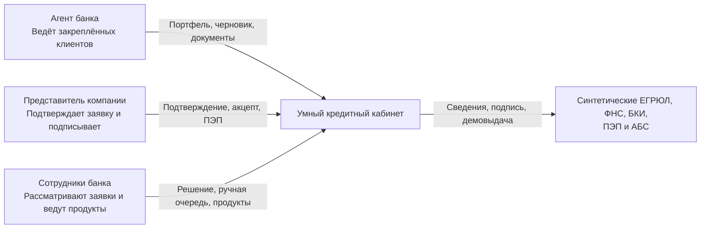
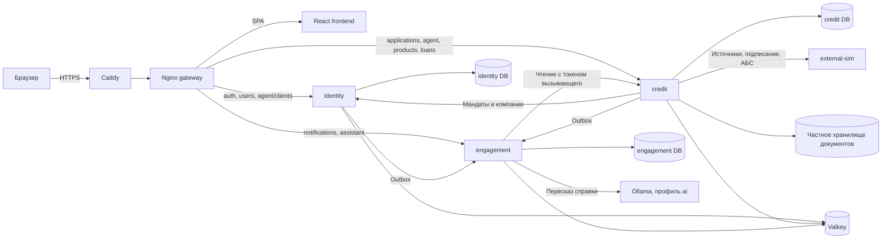
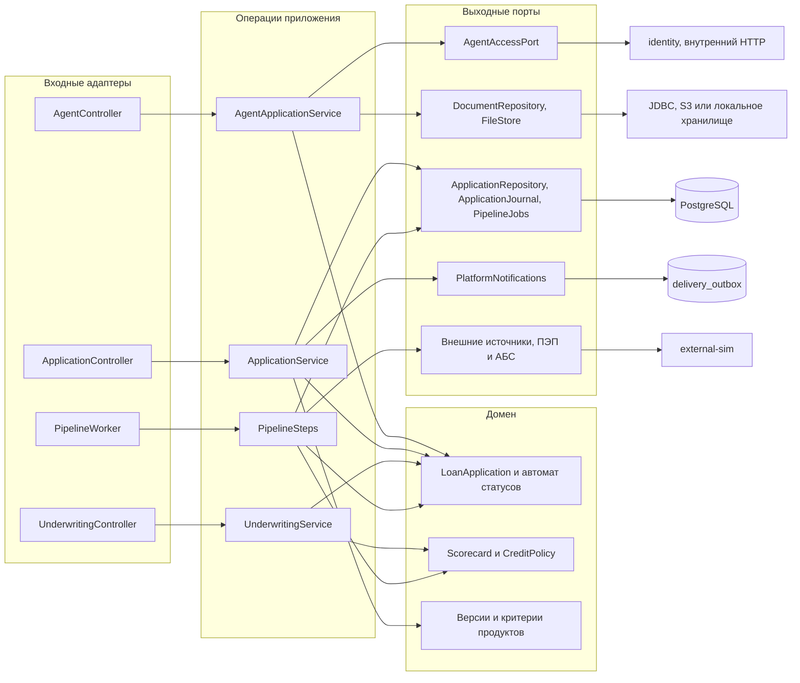
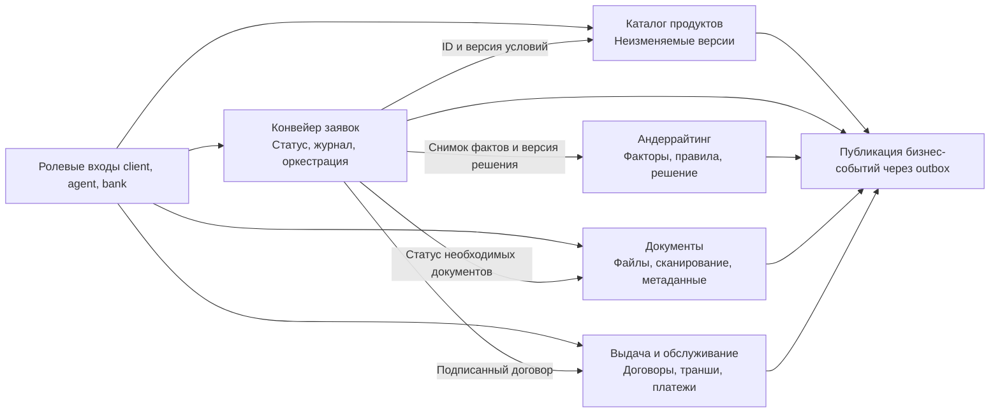

# Архитектура финального кабинета

Схемы описывают агентский контур и границы сервисов. Переходы заявки приведены в [конечном автомате](state-machine.md), права PostgreSQL и порядок восстановления в [операционной документации](database-isolation.md).

## C4 System Context

Агент и клиент работают с общей заявкой после запроса подтверждения. Действующий мандат проверяется в identity, а credit проверяет владельца заявки и разрешённый переход. Банк получает заявку после подтверждения клиентом и согласия БКИ.

## C4 Container

Входящий шлюз маршрутизирует публичные контуры. Доступ к `/internal/` и `/ext/` через него закрыт. Веб-процессы работают под собственными ролями `*_app`, отдельно от владельцев схем. Помощник работает по правилам при отключении Ollama.

## C4 Component. Границы внутри credit

Запись перехода, журнала, следующей задачи и уведомления выполняется в БД credit. Вызовы к источникам идут вне транзакции. Обработка задач использует аренду и повтор. Идемпотентность операции АБС привязана к заявке.

## C4. Целевая эволюция credit

Каталог отдаёт неизменяемый снимок по версии. Андеррайтинг получает версионированные факты. Документы выносятся после согласования проверки прав на заявку и атомарного связывания файла с метаданными. Выдача выносится после проверки идемпотентного ключа и обработки повторных сообщений. На каждой границе владелец данных меняет своё состояние и пишет outbox в одной транзакции. Потребитель хранит ключ обработанного события, а конвейер отображает ожидающий статус до подтверждения. Разделение на отдельные процессы относится к целевой архитектуре.
