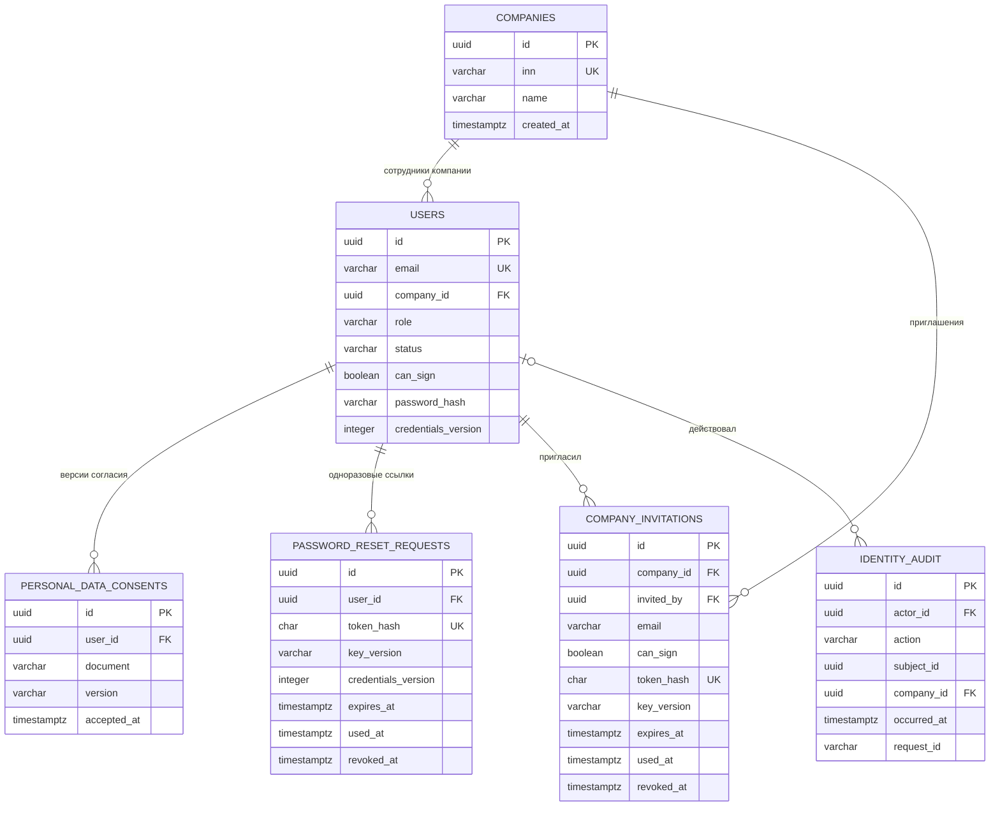
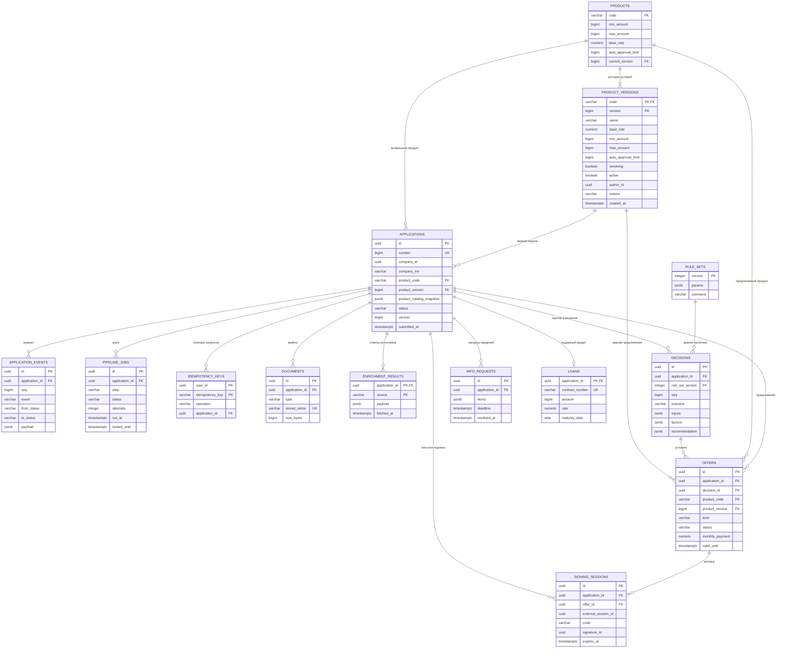
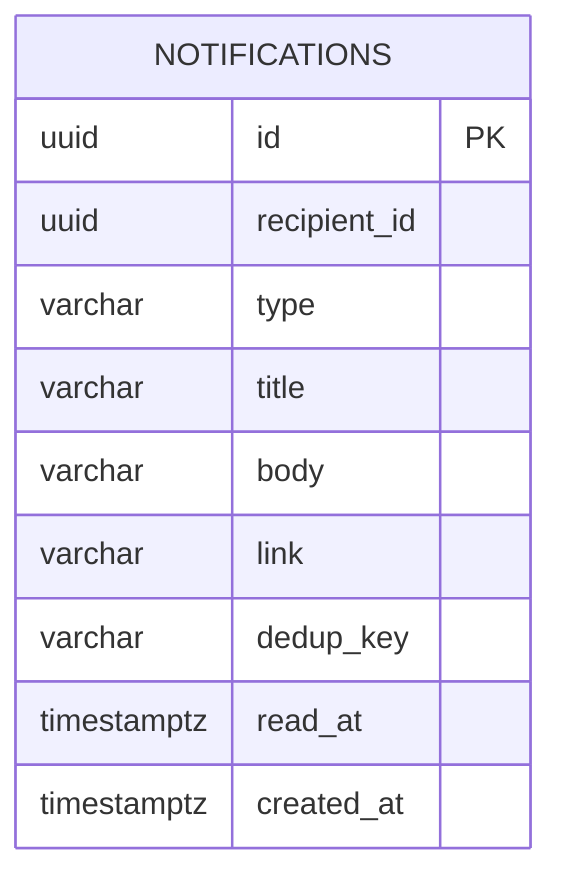

# Модель данных

Источник схемы — неизменённые миграции `services/*/src/main/resources/db/migration/`.
У каждого сервиса своя база. UUID компании, пользователя и получателя в другой базе
являются логическими ссылками, а не межсервисными внешними ключами PostgreSQL.

Каждой схемой владеет отдельный *_owner, runtime использует *_app. Изоляция ролей
не добавляет бизнес-таблиц и не меняет старые миграции; права существующих и новых
объектов согласует [bootstrap и одноразовый мигратор](database-isolation.md).

## Identity

Миграция `V5__account_access.sql` добавляет `password_reset_requests` (хэш ссылки, версия
учётных данных, срок 30 минут, использование/отмена), `company_invitations` (компания,
приглашающий, email, право подписи, хэш, срок 72 часа, принятие/отмена), `identity_audit`
(кто, действие, субъект, компания, время, request ID) и `identity_mutation_keys` (ключ
повтора, хэш несекретных параметров, UUID результата). Активное приглашение на адрес в
компании уникально. В таблицах и outbox нет открытых паролей или токенов ссылок; пароли
остаются bcrypt-хэшами в `users`. `identity_rate_buckets` хранит только SHA-256 ключей
лимита и счётчики запросов восстановления за 15 минут.

Триггер запрещает UPDATE и DELETE `identity_audit`; журнал пополняется в той же транзакции,
что и действие. Это защита прикладных изменений, а не от суперпользователя БД. Отзыв,
смена и восстановление пароля повышают `users.credentials_version` точечной записью под
блокировкой пользователя. Изменения сотрудников сначала блокируют компанию, затем
повторно проверяют действующего подписанта и сохраняют хотя бы одного активного подписанта.
Принятие приглашения использует тот же порядок и записывает согласие на обработку данных.

| Таблица | Назначение и ограничения |
| --- | --- |
| `companies` | ИНН уникален; имя и дата подключения. Организационная форма определяется по ИНН, отдельного столбца в этой таблице нет |
| `users` | Email уникален; роль, состояние, bcrypt-хэш, право подписи и версия учётных данных. Пользователь банка не имеет компании; `can_sign` требует компании |
| `personal_data_consents` | Кто, какую редакцию документа и когда принял. Отложенный FK позволяет сохранить пользователя и согласие одной транзакцией |

Триггер согласий запрещает `UPDATE`, чтобы ранее принятое согласие нельзя было
переписать. В текущей миграции он не запрещает `DELETE`; FK пользователя имеет
`ON DELETE CASCADE`. Публичного API удаления пользователя/согласия нет. Это граница
имеющейся защиты, а не гарантия неизменности против администратора БД.

## Credit

| Таблица | Ключевые данные и смысл |
| --- | --- |
| `products` | Стабильный код, порядок отображения и `current_version`; прежние поля оставлены для совместимости миграций, действующие условия читаются из `product_versions` |
| `product_versions` | PK `(code, version)`, полные условия, `active`, автор UUID, причина, время; CHECK диапазонов, ставка и цели, UPDATE/DELETE запрещены |
| `applications` | Снимок компании и условий, согласие БКИ, статус и даты. `version` нужен для optimistic locking. `product_version` с составным FK и `product_catalog_snapshot` (код → версия) фиксируются при подаче и далее неизменяемы. Номер выдаётся последовательностью; частичный уникальный индекс допускает одну активную заявку компании на продукт |
| `application_events` | Из какого статуса в какой, действие, автор, причина, комментарий и payload. `seq` упорядочивает события при одинаковом времени |
| `pipeline_jobs` | Следующий шаг и срок запуска; состояние, попытки, ошибка и аренда `locked_until`. Частичный уникальный индекс допускает одну открытую задачу на пару заявка/шаг |
| `idempotency_keys` | PK — пользователь и ключ; операция сохранена отдельным полем. Ключ отправки связан с конкретной заявкой и не создаёт повторного перехода |
| `documents` | Метаданные, автор, тип и случайное имя объекта. Байты находятся в отдельном томе, не в PostgreSQL; полное восстановление требует обоих хранилищ |
| `enrichment_results` | По одному сохранённому ответу каждого источника на заявку; JSONB и время получения |
| `rule_sets` | Версия порогов и параметров с причиной изменения; новые оценки используют новую версию |
| `decisions` | Версия правил, входные данные, баллы факторов, рейтинг, стоп-факторы, причины ручного решения и рекомендация. Это снимок оценки, а не ссылка на меняющиеся внешние данные |
| `info_requests` | Перечень файлов/вопросов, срок, автор, время ответа и комментарий. Новый запрос не переписывает историю предыдущего |
| `offers` | Запрошенные или изменённые условия, решение-основание, срок и состояние принятия. Денежные платежи хранятся с двумя знаками |
| `signing_sessions` | Связь с оффером и сессией симулятора, срок, подпись и подписант. Код хранится открыто и показывается на демо-стенде |
| `loans` | Один кредит на заявку; уникальный номер договора и сохранённые реквизиты выдачи. График вычисляется из условий кредита |

`application_events` защищён от `UPDATE` и `DELETE` триггером: аудит должен сохранять
последовательность действий и основания решений. Администратор БД, способный снять
триггер, остаётся доверенной стороной. Старые версии `rule_sets` и снимки `decisions`
приложение сохраняет добавлением записей; отдельного SQL-триггера неизменности у них нет.
Изменяемые сущности — черновик заявки, задания, состояние оффера и разрешение запроса
сведений — не следует смешивать с неизменяемым журналом.

## Переписка заявки (credit V7)

`application_chat_state` хранит последний выданный номер. `application_messages` —
неизменяемые сообщения с автором, стороной, простым текстом, номером, ключом повтора
и хэшем тела. Уникальны `(application_id, seq)` и `(application_id, author_id, idempotency_key)`.
`application_chat_read_cursors` хранит монотонный курсор по стороне `COMPANY`/`BANK`;
номер не может превышать состояние переписки. `application_chat_audit` содержит только
метаданные действий и ссылки на сообщение/документ, без копии текста.

`message_attachments` связывает сообщение с существующим документом составными
внешними ключами с `application_id`. `documents.context` отделяет `BUSINESS` от `CHAT`;
старые файлы остаются `BUSINESS`. `application_chat_upload_keys` фиксирует результат
идемпотентной загрузки. Сообщения, связи, аудит и квитанции загрузки защищены триггерами
от изменения и удаления; метаданные опубликованного файла также неизменяемы.
`application_chat_rate_buckets` — общий промежуточный счётчик отправок до Valkey.
Ни одна из этих записей не создаёт событие финансового бизнес-журнала.

## Engagement

`notifications.recipient_id` логически ссылается на `identity.users.id`, физического
FK нет. Индекс `(recipient_id, dedup_key)` исключает повтор доставки с непустым ключом;
`read_at` меняется отдельно для каждого человека. Ссылка ограничена путём внутри кабинета.
У помощника нет собственной таблицы диалогов: история приходит в запросе, а факты
заявки запрашиваются у `credit` с токеном пользователя.

## Очереди доставки

Identity и credit владеют таблицей `delivery_outbox` в своих базах (новые миграции V4),
engagement — такой же очередью для email (V3).
Она хранит `id`, `channel`, уникальный `event_key` внутри канала, JSON `payload`,
`state`, `attempts`, `next_attempt_at`, `claim_token`, `locked_until`, код последней
ошибки и даты создания/изменения/доставки. Индексы отдельно выделяют ожидающие и
арендованные записи. Запись события атомарна с бизнес-транзакцией; сеть не участвует
в ней. Результат старой аренды не может заменить новую.

Engagement хранит `notification_receipts` (V2): ключ события, исходный payload и дату
первого успешного приёма. Receipt неизменяем и фиксируется вместе с уведомлениями
получателей. Повтор не раскрывает компанию заново и не добавляет новых адресатов.
Неуспешный пакет откатывается целиком. Это отдельная таблица от `notifications`,
у которых индивидуальные отметки прочтения продолжают изменяться.

`notification_preferences` в engagement (V3) хранит только `user_id`, `email_enabled`,
оптимистическую `version` и дату изменения. Почта, имя и роль остаются в identity.
Отсутствие строки означает выключенное дублирование и версию 0.

## External-sim и служебные данные

У `external-sim` нет PostgreSQL-схемы. Сценарные компании читаются из JSON, прочие
синтетические компании воспроизводимо выводятся из ИНН с `00`. Режимы сбоев,
сессии подписания и реестр смоделированных выдач хранятся в памяти процесса.
Они не попадают в backup PostgreSQL и теряются при перезапуске симулятора.

Каждая из трёх баз также содержит служебную `flyway_schema_history`: она ведётся
Flyway и не является бизнес-таблицей. Существующие миграции не редактируются;
изменение структуры оформляется новой миграцией и проверяется сборкой.
