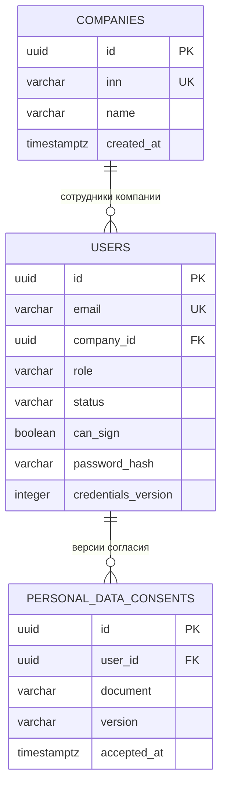
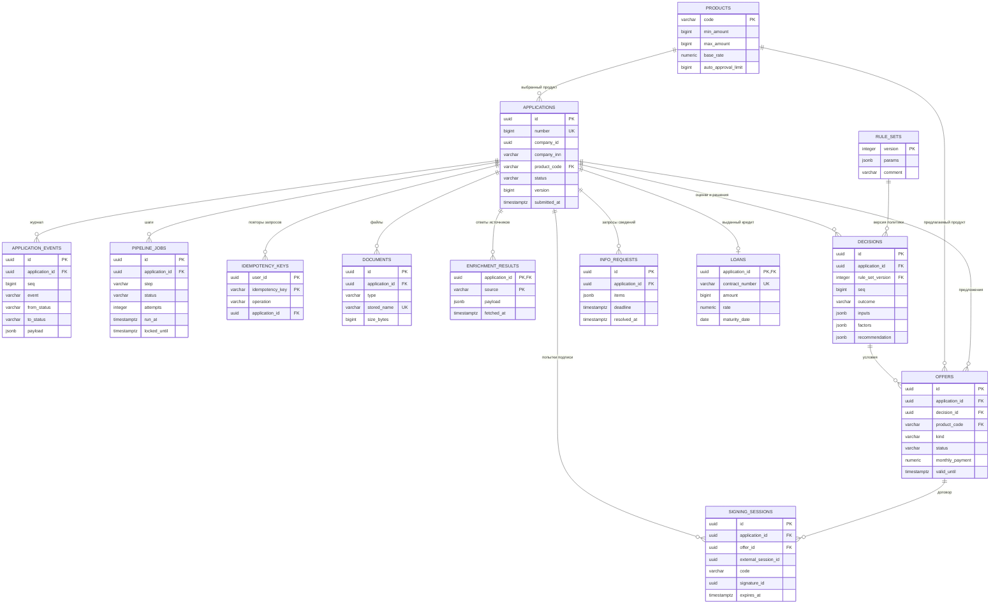
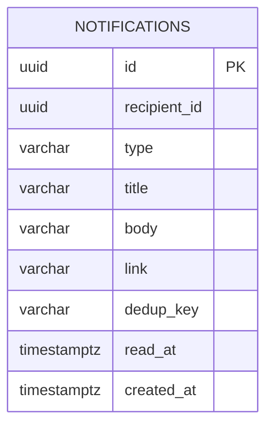

# Модель данных

Источник схемы — неизменённые миграции `services/*/src/main/resources/db/migration/`.
У каждого сервиса своя база. UUID компании, пользователя и получателя в другой базе
являются логическими ссылками, а не межсервисными внешними ключами PostgreSQL.

## Identity

| Таблица | Назначение и ограничения |
| --- | --- |
| `companies` | ИНН уникален; имя и дата подключения. Организационная форма определяется по ИНН, отдельного столбца в этой таблице нет |
| `users` | Email уникален; роль, состояние, bcrypt-хэш, право подписи и версия учётных данных. Пользователь банка не имеет компании; `can_sign` требует компании |
| `personal_data_consents` | Кто, какую редакцию документа и когда принял. Отложенный FK позволяет сохранить пользователя и согласие одной транзакцией |

Триггер согласий запрещает `UPDATE`, чтобы ранее принятое согласие нельзя было
переписать. В текущей миграции он не запрещает `DELETE`; FK пользователя имеет
`ON DELETE CASCADE`. Публичного API удаления пользователя/согласия нет. Это граница
имеющейся защиты, а не гарантия неизменности против администратора БД.

## Credit

| Таблица | Ключевые данные и смысл |
| --- | --- |
| `products` | Коды, цели, диапазоны суммы/срока, ставка, лимит автоодобрения, признак возобновляемого лимита; `CHECK` проверяет диапазоны |
| `applications` | Снимок компании и условий, согласие БКИ, статус и даты. `version` нужен для optimistic locking. Номер выдаётся последовательностью; частичный уникальный индекс допускает одну активную заявку компании на продукт |
| `application_events` | Из какого статуса в какой, действие, автор, причина, комментарий и payload. `seq` упорядочивает события при одинаковом времени |
| `pipeline_jobs` | Следующий шаг и срок запуска; состояние, попытки, ошибка и аренда `locked_until`. Частичный уникальный индекс допускает одну открытую задачу на пару заявка/шаг |
| `idempotency_keys` | PK — пользователь и ключ; операция сохранена отдельным полем. Ключ отправки связан с конкретной заявкой и не создаёт повторного перехода |
| `documents` | Метаданные, автор, тип и случайное имя объекта. Байты находятся в отдельном томе, не в PostgreSQL; полное восстановление требует обоих хранилищ |
| `enrichment_results` | По одному сохранённому ответу каждого источника на заявку; JSONB и время получения |
| `rule_sets` | Версия порогов и параметров с причиной изменения; новые оценки используют новую версию |
| `decisions` | Версия правил, входные данные, баллы факторов, рейтинг, стоп-факторы, причины ручного решения и рекомендация. Это снимок оценки, а не ссылка на меняющиеся внешние данные |
| `info_requests` | Перечень файлов/вопросов, срок, автор, время ответа и комментарий. Новый запрос не переписывает историю предыдущего |
| `offers` | Запрошенные или изменённые условия, решение-основание, срок и состояние принятия. Денежные платежи хранятся с двумя знаками |
| `signing_sessions` | Связь с оффером и сессией симулятора, срок, подпись и подписант. Код хранится открыто и показывается на демо-стенде |
| `loans` | Один кредит на заявку; уникальный номер договора и сохранённые реквизиты выдачи. График вычисляется из условий кредита |

`application_events` защищён от `UPDATE` и `DELETE` триггером: аудит должен сохранять
последовательность действий и основания решений. Администратор БД, способный снять
триггер, остаётся доверенной стороной. Старые версии `rule_sets` и снимки `decisions`
приложение сохраняет добавлением записей; отдельного SQL-триггера неизменности у них нет.
Изменяемые сущности — черновик заявки, задания, состояние оффера и разрешение запроса
сведений — не следует смешивать с неизменяемым журналом.

## Engagement

`notifications.recipient_id` логически ссылается на `identity.users.id`, физического
FK нет. Индекс `(recipient_id, dedup_key)` исключает повтор доставки с непустым ключом;
`read_at` меняется отдельно для каждого человека. Ссылка ограничена путём внутри кабинета.
У помощника нет собственной таблицы диалогов: история приходит в запросе, а факты
заявки запрашиваются у `credit` с токеном пользователя.

## External-sim и служебные данные

У `external-sim` нет PostgreSQL-схемы. Сценарные компании читаются из JSON, прочие
синтетические компании воспроизводимо выводятся из ИНН с `00`. Режимы сбоев,
сессии подписания и реестр смоделированных выдач хранятся в памяти процесса.
Они не попадают в backup PostgreSQL и теряются при перезапуске симулятора.

Каждая из трёх баз также содержит служебную `flyway_schema_history`: она ведётся
Flyway и не является бизнес-таблицей. Существующие миграции не редактируются;
изменение структуры оформляется новой миграцией и проверяется сборкой.
