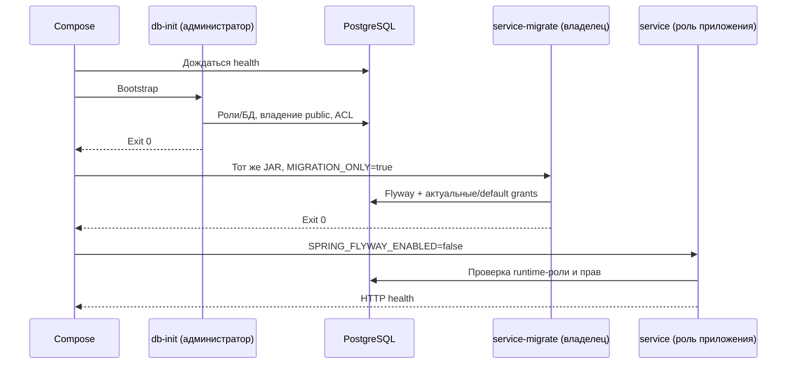

# Права PostgreSQL и отдельные миграции

Каждый HTTP-сервис получает только пароль своей роли приложения. Bootstrap и
миграторы не обслуживают HTTP; external-sim не получает пароль PostgreSQL.

| База | HTTP-процесс | Мигратор | Секреты окружения установки |
| --- | --- | --- | --- |
| identity | identity_app | identity_owner | IDENTITY_DB_PASSWORD, IDENTITY_MIGRATION_PASSWORD |
| credit | credit_app | credit_owner | CREDIT_DB_PASSWORD, CREDIT_MIGRATION_PASSWORD |
| engagement | engagement_app | engagement_owner | ENGAGEMENT_DB_PASSWORD, ENGAGEMENT_MIGRATION_PASSWORD |

Приложения не superuser, не создают базы, роли, схемы, таблицы или временные таблицы;
не владеют отношениями, не обходят RLS, не имеют членства в других ролях. Они имеют
CONNECT только к своей базе, USAGE public, CRUD бизнес-таблиц, USAGE/SELECT
последовательностей и EXECUTE функций. TRUNCATE/TRIGGER не выдаются. PUBLIC теряет
CONNECT/TEMP к сервисным и административным cabinet/postgres/template* базам.
Runtime guard проверяет границу до открытия приложения в Compose и prod.

На personal_data_consents, identity_audit, application_events, product_versions,
application_messages, message_attachments, application_chat_audit,
application_chat_upload_keys, notification_receipts у приложения только SELECT/INSERT.
История Flyway доступна только для чтения. Ограничения не защищают от владельца схемы
или администратора PostgreSQL: их секреты остаются у оператора.

## Порядок старта



Bootstrap принимает фиксированные имена баз/ролей. Перенос владения ограничен public
конкретной базы: глобальный REASSIGN OWNED администратора мог бы затронуть другие БД.
Пароли не передаются в аргументах psql и не выводятся в отчёт. Общий
database-permissions.sql настраивает ACL и default privileges после миграции;
EXECUTE для PUBLIC снимается на уровне владельца, а не только схемы.
Мигратор использует образ своего сервиса, отдельный пароль и 192 MiB, без Spring HTTP.
Flyway сериализует миграции одной БД, ACL защищены advisory lock. Старые SQL не меняются.

## Обновление существующей установки

Сделайте штатную резервную копию и сохраните прежний env. Не меняйте POSTGRES_PASSWORD
существующего тома. Добавьте шесть независимых секретов в новый файл:

```bash
python deploy/upgrade-database-env.py --env-file deploy/.env --output deploy/.env.roles
python deploy/start.py --project cabinet-prod --env-file deploy/.env.roles --check-only
python deploy/start.py --project cabinet-prod --env-file deploy/.env.roles
python deploy/verify.py --project cabinet-prod --env-file deploy/.env.roles
```

Утилита сохраняет прежние значения/комментарии, не перезаписывает output и создаёт
mode 0600 на Linux. Windows требует закрытых ACL каталога. Для последующих команд
используйте тот же новый --env-file. start.py останавливает Caddy и три сервиса-писателя
перед bootstrap/migrate; HTTPS открывается после health и блокировки демо-аккаунтов.

Для dev сохраните прежние project name, compose-файлы, env и профили. Перед
`docker compose up -d --build --wait` остановите identity/credit/engagement. При
изменении кода пересобирайте образы: старый завершившийся мигратор не подтверждает
новый JAR. Проверьте exit 0 трёх *-migrate и health приложений.

restore.py после `pg_restore --no-owner --no-acl` повторно запускает bootstrap,
назначает владельцев/ACL, затем миграторы завершают схему до старта HTTP. Пароли берутся
из env целевой установки, а не дампа глобальных ролей. Старый manifest v1 local поддержан.

## Проверка и диагностика

На отдельном синтетическом стенде с двумя репликами каждого сервиса:

```bash
python security/db-permissions.py --project cabinet-e2e --report-name db-permissions
```

Реальные runtime-пароли проверяются через TCP: чужие и административные базы отказывают
в CONNECT; DDL, SET ROLE, изменение/удаление аудита и истории Flyway запрещены;
обычный CRUD и последовательности работают. Временная таблица проверяет default grants
и удаляется в finally. Скрипт допускает только выделенные disposable-проекты.

При ошибке мигратора смотрите exit code/журнал; не включайте Flyway в runtime и не
заменяйте *_app на владельца. При permission denied сверяйте базу/роль и успех db-init
и мигратора. Восстанавливайте ACL штатным bootstrap после остановки писателей,
не выдавайте SUPERUSER/ALL и не отключайте runtime guard.

Локально: свежие две реплики — 87 проверок, 72 отказа; обновление сохранило 38 таблиц
и все последовательности; два одновременных мигратора credit оставили одну историю
из 8 миграций. Prod local: 20 компаний, восстановление manifest v1, 16 проверок;
права до/после восстановления — по 84 проверки и 72 отказа. S3 также провёл 20 компаний
до выдачи и прошёл 16 проверок с независимым восстановлением manifest v2. Пик суммы
контейнеров — 2694,3 MiB; OOM/restart не наблюдались. Права проверены с обеих сторон.

Дополнительно: 170 серверных тестов, 38 E2E без почты и 8 с почтой (1440/375 px),
семь квот на двух репликах, десять проверок отзыва сессий и 14 запросов при отказах.
Linux-проверка additive env подтвердила mode 0600. JAR-содержимое всех семи работающих
Java-реплик и frontend dist совпали с локальными сборками.

Первый E2E при одновременных тяжёлых проверках дал 35/38: исправлен неоднозначный
локатор ИНН; отдельно наблюдались отсутствие сессии подписи и 503 лимитера. Первый
shared-state остановился по curl timeout. Повторные последовательные прогоны прошли
с прежними таймаутами; влияние конкурирующей нагрузки предполагается, но причинно
не доказано. Эти первые ошибки не выдаются за успешные результаты.
CI нового SHA оценивается отдельно от локальных проверок.

Числа, ID проверенных образов и результаты сканера собраны в
[машиночитаемом отчёте](security-results/database-isolation.json). Четыре Java-образа
не содержат HIGH/CRITICAL или найденных секретов; source/tool scan отдельно содержит
19 HIGH. Средние/низкие находки и действующие ограниченные исключения не скрываются.
