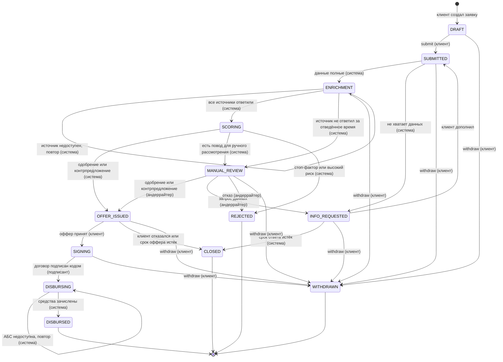

# Статусы заявки

Заявка — конечный автомат: статус меняется только через переходы из таблицы ниже, каждый
переход записывается в журнал событий заявки. Этапы и правила решения описаны в
[process-model.md](process-model.md).

## 1. Диаграмма

`SCORING` и `DISBURSING` — короткие системные статусы: в них заявка находится, пока выполняется
задача конвейера. Клиенту они показываются как «Оцениваем заявку» и «Зачисляем средства».

**Почему одобрение и контрпредложение — не отдельные статусы.** Для клиента и для конвейера
следующий шаг у них одинаковый: посмотреть условия и принять или отказаться. Вид оффера
(`APPROVED` — на запрошенных условиях, `COUNTER` — на изменённых) хранится в самом оффере и
определяет, как он показывается («Одобрено» или «Можем предложить другие условия» с
сравнением «запрошено → предложено»).

## 2. Статусы

| Статус | Конечный | Клиенту показываем | Что нужно от клиента | Кто действует |
| --- | --- | --- | --- | --- |
| `DRAFT` | нет | Черновик | Заполнить и отправить | Клиент |
| `SUBMITTED` | нет | Заявка принята, проверяем данные | Ничего | Система |
| `INFO_REQUESTED` | нет | Нужны дополнительные данные | Выполнить задачи из списка до указанного срока | Клиент |
| `ENRICHMENT` | нет | Запрашиваем сведения о компании в реестрах и БКИ | Ничего | Система |
| `SCORING` | нет | Оцениваем заявку | Ничего | Система |
| `MANUAL_REVIEW` | нет | Заявку рассматривает специалист банка | Ничего; срок рассмотрения указан | Андеррайтер |
| `OFFER_ISSUED` | нет | Одобрено / Можем предложить другие условия | Принять или отказаться до указанного срока | Клиент |
| `SIGNING` | нет | Подпишите договор | Подписать кодом (только подписант компании) | Клиент |
| `DISBURSING` | нет | Зачисляем средства | Ничего | Система |
| `DISBURSED` | да | Деньги на счёте | — (график платежей доступен) | — |
| `REJECTED` | да | Банк не может выдать кредит | — (причина и что можно изменить) | — |
| `WITHDRAWN` | да | Вы отозвали заявку | — | — |
| `CLOSED` | да | Заявка закрыта: срок ответа истёк / вы отказались от предложения | — (можно создать новую на основе этой) | — |

## 3. Переходы

| # | Из | Событие | Кто | Условие (guard) | В | Побочные эффекты |
| --- | --- | --- | --- | --- | --- | --- |
| T1 | — | `create` | Клиент | Пользователь состоит в компании; у компании нет активной заявки на этот продукт | `DRAFT` | — |
| T2 | `DRAFT` | `submit` | Клиент | Обязательные поля заполнены и валидны (ИНН, сумма и срок в лимитах продукта); даны согласия на обработку ПД и запрос в БКИ | `SUBMITTED` | Задача «проверка полноты»; уведомление «заявка принята» |
| T3 | `SUBMITTED` | `dataComplete` | Система | Все документы, обязательные для продукта и суммы, загружены и прошли проверку формата | `ENRICHMENT` | Задачи запроса в ЕГРЮЛ, ФНС, БКИ, обороты |
| T4 | `SUBMITTED` | `dataIncomplete` | Система | Не хватает документов или полей | `INFO_REQUESTED` | Список задач клиенту, срок ответа; уведомление |
| T5 | `INFO_REQUESTED` | `infoProvided` | Клиент | Все задачи из списка выполнены | `SUBMITTED` | Задача «проверка полноты» |
| T6 | `INFO_REQUESTED` | `infoExpired` | Система | Срок ответа истёк | `CLOSED` (`INFO_EXPIRED`) | Уведомление |
| T7 | `ENRICHMENT` | `sourceFailed` | Система | Источник не ответил, попытки не исчерпаны | `ENRICHMENT` | Повтор задачи с паузой; клиенту — «один из источников отвечает медленно» |
| T8 | `ENRICHMENT` | `enrichmentDone` | Система | Ответы всех источников сохранены | `SCORING` | Задача «скоринг и решение» |
| T9 | `ENRICHMENT` | `sourceTimedOut` | Система | Источник не ответил за отведённое время | `MANUAL_REVIEW` (повод `SOURCE_UNAVAILABLE`) | Задача в очередь андеррайтера |
| T10 | `SCORING` | `autoOffer` | Система | Решение «одобрение» или «контрпредложение» | `OFFER_ISSUED` | Оффер со сроком действия; уведомление |
| T11 | `SCORING` | `toManualReview` | Система | Сработал повод ручного рассмотрения | `MANUAL_REVIEW` | Задача в очередь андеррайтера; уведомление «рассматривает специалист» |
| T12 | `SCORING` | `autoReject` | Система | Стоп-фактор или недопустимый риск | `REJECTED` | Код причины; уведомление |
| T13 | `MANUAL_REVIEW` | `approve` / `counterOffer` | Андеррайтер | Условия в лимитах продукта; если отличается от рекомендации системы — указана причина | `OFFER_ISSUED` | Оффер; уведомление |
| T14 | `MANUAL_REVIEW` | `requestInfo` | Андеррайтер | Указан хотя бы один пункт запроса | `INFO_REQUESTED` | Список задач клиенту; уведомление |
| T15 | `MANUAL_REVIEW` | `reject` | Андеррайтер | Указаны код и текст причины | `REJECTED` | Уведомление |
| T16 | `OFFER_ISSUED` | `acceptOffer` | Клиент | Оффер не истёк | `SIGNING` | Формирование договора из оффера; выпуск одноразового кода |
| T17 | `OFFER_ISSUED` | `declineOffer` / `offerExpired` | Клиент / Система | — / срок оффера истёк | `CLOSED` (`OFFER_DECLINED` / `OFFER_EXPIRED`) | Уведомление |
| T18 | `SIGNING` | `sign` | Подписант | Код верный, не истёк; у пользователя право подписи за компанию; 5 неверных попыток → код аннулируется, выпускается новый | `DISBURSING` | Задача «выдача» |
| T19 | `DISBURSING` | `disbursementFailed` | Система | АБС не ответила, попытки не исчерпаны | `DISBURSING` | Повтор задачи с паузой |
| T20 | `DISBURSING` | `disbursed` | Система | АБС подтвердила зачисление | `DISBURSED` | Номер договора и счёта, график платежей; уведомление |
| T21 | любой нетерминальный, кроме `SCORING` и `DISBURSING` | `withdraw` | Клиент | — | `WITHDRAWN` | Отмена незавершённых задач конвейера; уведомление банку, если заявка была на ручном рассмотрении |

Всё, что не указано в таблице, запрещено: попытка перехода из неподходящего статуса отвечает
`409 Conflict` с понятным текстом («Заявка уже на рассмотрении, изменить её нельзя»).

## 4. Инварианты

- **Один переход — одна транзакция.** Смена статуса, запись в журнал событий и постановка
  следующей задачи конвейера сохраняются вместе (transactional outbox). Если процесс упал
  после коммита, задача всё равно будет выполнена; если до — не будет ни статуса, ни задачи.
- **Оптимистичная блокировка.** У заявки есть `version`; если два действия пришли одновременно
  (клиент отзывает, андеррайтер одобряет), второе получит `409` и увидит актуальный статус.
- **Идемпотентность.** `submit`, `acceptOffer`, `sign` принимают заголовок `Idempotency-Key`:
  повторный запрос возвращает тот же результат, а не второй переход. Задачи конвейера
  идемпотентны по ключу `заявка + шаг + попытка`.
- **Данные заявки замораживаются после `submit`.** Клиент меняет их только в `INFO_REQUESTED`
  и только в пределах запрошенного; каждое изменение пишется в журнал.
- **Решение воспроизводимо.** Скоринг и решение сохраняют снимок входных данных и версию набора
  правил; смена правил не меняет уже принятые решения.
- **Конечные статусы не меняются.** Новая попытка — новая заявка (можно создать копией прежней).
- **Права.** Клиент видит заявки только своей компании (чужая — `404`); подписывать может только
  пользователь с правом подписи; переходы андеррайтера доступны только ролям банка; система
  выполняет свои переходы только из воркера конвейера, а не через публичный API.

## 5. Журнал событий

Каждый переход пишет запись в `application_events`:

| Поле | Пример |
| --- | --- |
| `application_id` | id заявки |
| `from_status` / `to_status` | `SCORING` → `MANUAL_REVIEW` |
| `event` | `toManualReview` |
| `actor_type` / `actor_id` | `SYSTEM` / — ; `UNDERWRITER` / id сотрудника |
| `reason_code` / `comment` | `AMOUNT_ABOVE_AUTO_LIMIT` / — |
| `payload` | детали (условия оффера, список запрошенного) |
| `occurred_at` | время |

Из журнала строятся:
- **история заявки** для клиента — шкала этапов с датами (технические события скрыты);
- **аудит** для банка — все события, кто и почему;
- **воронка и время на этапе** для риск-администратора — без отдельного хранилища аналитики.
